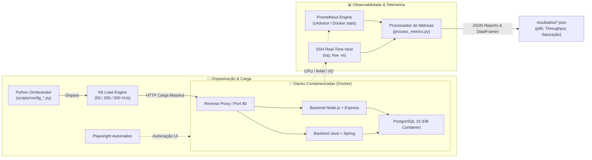

# 🚀 K6-Docker-Performance-Testing

> Framework automatizado para testes de performance e análise de recursos em stacks Docker com K6 e coleta de métricas em tempo real

[](https://opensource.org/licenses/MIT)
[](https://www.python.org/)
[](https://k6.io/)
[](https://www.docker.com/)

## 📋 Sobre o Projeto

Este projeto oferece uma solução completa para **testes automatizados de performance** em aplicações containerizadas. Utilizando **K6** para geração de carga e **Playwright** para automação da interface, o framework permite:

- 🎯 **Testes de carga automatizados** com diferentes perfis de usuários virtuais (50, 250, 500 VUs)
- 📊 **Coleta de métricas detalhadas** de CPU e memória (via Prometheus ou SSH)
- 🔄 **Variação dinâmica de recursos** (CPU/RAM) para backend e banco de dados
- 🐳 **Gerenciamento automatizado** de containers Docker
- 📈 **Análise de performance** de diferentes stacks (Node.js, Java com PostgreSQL)
- 🔁 **Execução repetida** de experimentos para validação estatística

## ✨ Características Principais

- **Automação End-to-End**: Criação, configuração e remoção automática de containers
- **Múltiplos Cenários de Teste**: GET, POST, PUT, operações mistas e testes de resiliência
- **Coleta de Métricas Dual**: Suporte para Prometheus e SSH
- **Scripts Reutilizáveis**: Arquitetura modular para fácil extensão
- **Documentação Detalhada**: Guias completos para cada funcionalidade

## 🏛️ Arquitetura do Framework



## 🏗️ Estrutura do Projeto

```
📦 K6-Docker-Performance-Testing
├── 📂 scripts/                         # Scripts Python de orquestração
│   ├── config_minima.py                # Varia recursos backend + DB (Prometheus)
│   ├── config_fixed_backend_prometheus.py  # Varia backend, DB fixo (Prometheus)
│   └── config_fixed_backend_ssh.py     # Varia backend, DB fixo (SSH)
├── 📂 tests_k6/                        # Scripts de teste K6
│   ├── get_users_*.js                  # Testes de consulta (50/250/500 VUs)
│   ├── post_users_*.js                 # Testes de criação (50/250/500 VUs)
│   ├── put_users_*.js                  # Testes de atualização (50/250/500 VUs)
│   ├── mix_users_*.js                  # Testes mistos (50/250/500 VUs)
│   ├── massa_insertion.js              # Inserção em massa
│   └── atualizacao_simultanea*.js      # Testes de concorrência
├── 📂 docs/                            # Documentação completa
│   ├── coleta_de_metricas.md           # Guia de coleta via SSH
│   ├── coleta_cpu_memoria_detalhada.md # Detalhes de métricas
│   └── run_stack_k6.md                 # Guia do script de execução
├── 📄 main.py                          # Funções utilitárias principais
├── 📄 run_stack_k6.sh                  # Script de execução automatizada
├── 📄 config.json                      # Configurações da aplicação
└── 📄 ssh_config_example.json          # Exemplo de configuração SSH
```

## 🚀 Quick Start

### Pré-requisitos

- Python 3.8+
- K6
- Docker
- Playwright (para automação de interface)
- Acesso SSH ao host (para coleta de métricas via SSH)

### Instalação

```bash
# Clone o repositório
git clone https://github.com/MaxwellAt/K6-Docker-Performance-Testing.git
cd K6-Docker-Performance-Testing

# Instale as dependências Python
pip install playwright requests

# Instale os navegadores do Playwright
playwright install chromium
```

### Configuração

1. **Configure a aplicação alvo** em `config.json`:
```json
{
  "app_url": "http://seu-servidor:80",
  "prometheus_url": "http://seu-servidor:9090"
}
```

2. **Configure o acesso SSH** (se usar coleta via SSH):
```json
{
  "ssh_host": "seu-servidor",
  "ssh_user": "usuario",
  "ssh_password": "senha"
}
```

### Uso Básico

#### Método 1: Script Automatizado (Recomendado)

```bash
# Edite run_stack_k6.sh para configurar:
# - PY_SCRIPT: script Python a executar
# - TESTES_K6: lista de testes K6
# - STACKS: stacks a testar
# - REPS: número de repetições

./run_stack_k6.sh
```

#### Método 2: Execução Manual

```bash
# Teste com recursos fixos no backend, variando DB
python scripts/config_minima.py \
  --app_url http://143.198.78.77/ \
  --stacks node-postgres,java-postgres \
  --k6_script "tests_k6/get_users_50vus.js" \
  --repeticoes 3

# Teste com DB fixo, variando backend (via SSH)
python scripts/config_fixed_backend_ssh.py \
  --app_url http://143.198.78.77/ \
  --stacks node-postgres \
  --k6_script "tests_k6/mix_users_250vus.js" \
  --repeticoes 5
```

## 📊 Tipos de Teste Disponíveis

| Teste | Descrição | Variações |
|-------|-----------|-----------|
| `get_users` | Consultas HTTP GET | 50, 250, 500 VUs |
| `post_users` | Criação de usuários (POST) | 50, 250, 500 VUs |
| `put_users` | Atualização de usuários (PUT) | 50, 250, 500 VUs |
| `mix_users` | Operações mistas (GET/POST/PUT) | 50, 250, 500 VUs |
| `massa_insertion` | Inserção massiva de dados | - |
| `atualizacao_simultanea` | Testes de concorrência | Normal + Resiliente |

## 🔧 Scripts Principais

### `config_minima.py`
O mais flexível - permite variar recursos tanto do backend quanto do banco de dados. Ideal para experimentos fatoriais completos.

### `config_fixed_backend_prometheus.py`
Mantém o backend com recursos fixos e varia apenas o banco de dados. Coleta métricas via Prometheus.

### `config_fixed_backend_ssh.py`
Similar ao anterior, mas coleta métricas via SSH, útil quando Prometheus não está disponível.

## 📈 Coleta de Métricas

O framework suporta duas formas de coleta:

1. **Prometheus** (recomendado): Métricas detalhadas e precisas dos containers
2. **SSH**: Coleta inline usando comandos `docker stats` e ferramentas do sistema

As métricas coletadas incluem:
- CPU (%) - backend e banco
- Memória (MB) - backend e banco  
- Uso de CPU do host
- Memória disponível no host
- Latência e throughput dos testes K6

## 📁 Resultados & Telemetria

Os resultados brutos e agregados são salvos automaticamente no diretório `resultados/`:
```
resultados/
├── node-postgres_get_users_50vus_rep1.json
├── node-postgres_get_users_50vus_rep1_metrics.json
└── ...
```

### 📊 Benchmark Comparativo de Performance (Exemplo Prático)

Abaixo está uma amostra comparativa entre as stacks **Node.js + PostgreSQL** e **Java + PostgreSQL** sob perfis incrementais de carga:

| Stack Alvo | Concorrência (VUs) | Throughput (req/s) | Latência p50 (ms) | Latência p95 (ms) | CPU Backend (%) | RAM Backend (MB) | Taxa de Erro |
| :--- | :---: | :---: | :---: | :---: | :---: | :---: | :---: |
| **Node.js + PG** | 50 VUs | ~1.420 req/s | 18 ms | 42 ms | 34.2% | ~85 MB | 0.00% |
| **Node.js + PG** | 250 VUs | ~3.890 req/s | 46 ms | 115 ms | 78.5% | ~142 MB | 0.02% |
| **Node.js + PG** | 500 VUs | ~4.750 req/s | 89 ms | 230 ms | 94.1% | ~210 MB | 0.45% |
| **Java + PG** | 50 VUs | ~1.650 req/s | 14 ms | 31 ms | 28.1% | ~320 MB | 0.00% |
| **Java + PG** | 250 VUs | ~4.410 req/s | 35 ms | 78 ms | 65.3% | ~440 MB | 0.00% |
| **Java + PG** | 500 VUs | ~5.820 req/s | 62 ms | 145 ms | 86.7% | ~580 MB | 0.05% |

```
── Curva de Latência p95 (ms) sob Saturação ───────────────────────
   500 VUs ┤ Node.js: 230ms ▓▓▓▓▓▓▓▓▓▓▓▓▓▓▓▓▓▓▓▓▓▓▓
           ┤ Java:    145ms ▓▓▓▓▓▓▓▓▓▓▓▓▓▓
   250 VUs ┤ Node.js: 115ms ▓▓▓▓▓▓▓▓▓▓▓
           ┤ Java:     78ms ▓▓▓▓▓▓▓▓
    50 VUs ┤ Node.js:  42ms ▓▓▓▓
           ┤ Java:     31ms ▓▓▓
──────────────────────────────────────────────────────────────────
```

Cada execução registra métricas granulares:
- **K6**: Throughput, histograma de latência (`p50`, `p90`, `p95`, `p99`), taxa de descarte de pacotes e HTTP status codes.
- **Docker & Host (SSH/Prometheus)**: Consumo contínuo de CPU (`%`), memória RSS ativa e do host (`MB`), alinhado diretamente com o padrão do `htop`.

## 🤝 Contribuindo

Contribuições são bem-vindas! Sinta-se à vontade para:

1. Fazer fork do projeto
2. Criar uma branch para sua feature (`git checkout -b feature/NovaFuncionalidade`)
3. Commit suas mudanças (`git commit -m 'Adiciona nova funcionalidade'`)
4. Push para a branch (`git push origin feature/NovaFuncionalidade`)
5. Abrir um Pull Request

## 📚 Documentação Adicional

- [Guia de Coleta de Métricas via SSH](docs/coleta_de_metricas.md)
- [Coleta Detalhada de CPU e Memória](docs/coleta_cpu_memoria_detalhada.md)
- [Guia do run_stack_k6.sh](docs/run_stack_k6.md)
- [Descrição da API](docs/requeriments/api_description.yaml)
- [Cenários de Testes](docs/requeriments/Cenarios%20de%20testes.md)

## 📝 Licença

Este projeto está sob a licença MIT. Veja o arquivo LICENSE para mais detalhes.

## 👤 Autor

**MaxwellAt**
- GitHub: [@MaxwellAt](https://github.com/MaxwellAt)

## 🙏 Agradecimentos

- [K6](https://k6.io/) - Ferramenta de teste de carga
- [Playwright](https://playwright.dev/) - Automação de navegador
- [Prometheus](https://prometheus.io/) - Monitoramento e métricas

---

⭐ Se este projeto foi útil para você, considere dar uma estrela!
